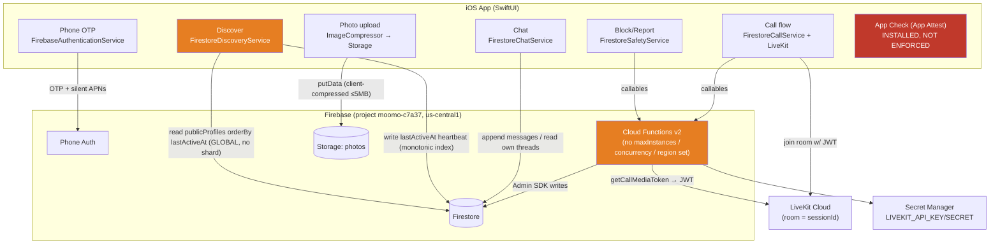

# Moomo — System Architecture (as-built)

_Audit date: 2026-07-20. Reflects the code in the repository, not a target design._

Moomo is a **speed-dating app**: the core loop is a short (3-minute) voice/video
call between two strangers matched in real time, followed by a mutual like/pass,
and — on a mutual like — a text conversation. The stack is an iOS SwiftUI client
talking to a Firebase backend (Firestore, Cloud Functions, Storage, Phone Auth)
with LiveKit for call media.

## Component inventory (verified in repo)

| Layer | Technology | Where |
|---|---|---|
| Client | SwiftUI, iOS, Swift concurrency | `app/Moomo` |
| Auth | Firebase Phone Auth (OTP only) | `FirebaseAuthenticationService.swift` |
| Backend logic | Cloud Functions v2 (Node 22, TypeScript) | `backend/functions/src` |
| Database | Cloud Firestore | `backend/firestore.rules`, `.indexes.json` |
| Blob storage | Firebase Storage (profile photos) | `backend/storage.rules` |
| Call media | LiveKit Cloud (WebRTC) | `media.ts`, `LiveKitCallMediaService.swift` |
| App integrity | Firebase App Check (App Attest) — **installed, not enforced** | `FirebaseBootstrap.swift` |
| Push | **None** — notifications are in-app Firestore docs only | `MoomoAppDelegate.swift` |
| Analytics | GoogleAppMeasurement linked; no explicit event wiring found | SPM deps |
| Crash reporting | **None** (Crashlytics not linked) | — |
| CI/CD | **None** — manual `firebase deploy` | (no `.github/workflows`) |

**Region:** all Cloud Functions run in the default `us-central1`; Firestore is
single-region. There is no multi-region or failover configuration.

## Cloud Functions (12 callables + 1 trigger)

All are bare `onCall` / `onDocumentCreated` with **no runtime options set** — no
`region`, `maxInstances`, `concurrency`, `memory`, `timeoutSeconds`,
`minInstances`, or `enforceAppCheck`. (Verified: `grep onCall backend/functions/src`.)

| Function | Auth gate | Rate limit | Notes |
|---|---|---|---|
| `joinMatchmakingQueue` | Auth | none | pairing transaction + stale sweep |
| `leaveMatchmakingQueue` | Auth | none | + stale sweep |
| `submitCallDecision` | Auth (participant) | none | only path that mints a match |
| `endCallSession` | Auth (participant) | none | idempotent |
| `getCallMediaToken` | Auth (participant) | none | mints LiveKit JWT |
| `blockUser` | Auth | 50/day | cascade + `recursiveDelete` |
| `unmatchUser` | Auth | none | cascade + `recursiveDelete` |
| `reportUser` | Auth | 20/day | write-only reports |
| `activateBoost` | Auth | 3/day (allowance) | free during beta |
| `deleteAccount` | Auth | none | sequential `recursiveDelete` of all owned data |
| `sendSystemNotification` | **admin claim** | none | ops only |
| `resolveReport` | **admin claim** | none | moderation primitive |
| `onMessageCreated` (trigger) | n/a | n/a | denormalizes chat preview + unread |

## Firestore data model

```
users/{uid}                              private account (owner r/w)
  ├─ private/onboarding                   resumable draft (owner r/w)
  ├─ callHistory/{sessionId}              per-user call view (server-write)
  └─ notifications/{id}                   bell feed (server-write, owner marks read)
publicProfiles/{uid}                      Discover projection (owner writes, ANY signed-in reads)
matchmakingQueue/{uid}                    queue entry (server-write, owner reads own)
callSessions/{id}                         call facts (server-write, participants read)
  └─ decisions/{uid}                      like/pass (closed to BOTH clients)
matches/{pairKey}                         mutual-like record (server-write)
conversations/{conv_pairKey}             one per match (server-write + per-user keys)
  └─ messages/{id}                        chat (participants append, no edit/delete)
blocks/{uid}/blocked/{uid}                block list (callable create, owner delete)
reports/{id}                              write-only, Admin-SDK read
unmatches/{id}                            write-only, Admin-SDK read
boosts/{uid}                              entitlement state (server-write)
```

**Ownership invariant (well enforced):** every collection that must not be
client-forgeable (`matches`, `callSessions`, `conversations`, `blocks`,
`reports`, `boosts`, queue, history, notifications) denies all client writes in
`firestore.rules`; only the Admin SDK (Cloud Functions) writes them. This is
verified by 135 passing rules tests.

## Request flow — matchmaking + call (the hot path)

```mermaid
sequenceDiagram
    participant A as Client A (iOS)
    participant F as Cloud Functions
    participant DB as Firestore
    participant LK as LiveKit Cloud
    participant B as Client B (iOS)

    A->>F: joinMatchmakingQueue(mode)
    F->>DB: sweepStaleQueueEntries() [txn, scan ≤50]
    F->>DB: read waiting head (status=waiting, mode, orderBy createdAt, limit 10)
    F->>DB: read ≤11 publicProfiles + block checks [txn]
    alt partner waiting & compatible & not blocked
        F->>DB: create callSession, set both queue=matched [txn]
        F-->>A: {matched, session}
        Note over B: B's listener on matchmakingQueue/{B} fires "matched"
    else nobody available
        F->>DB: set matchmakingQueue/{A}=waiting, publicProfiles.wantsToTalk=true
        F-->>A: {waiting}
        A->>DB: listen matchmakingQueue/{A} until matched or 30s timeout
    end
    A->>F: getCallMediaToken(sessionId)
    F->>DB: verify participant + live + within clock
    F-->>A: {url, JWT scoped to room=sessionId, ttl}
    A->>LK: join room (3-min speed call)
    B->>LK: join same room
    A->>F: endCallSession(sessionId, reason)
    F->>DB: mark ended, write both callHistory projections [txn]
    A->>F: submitCallDecision(sessionId, like|pass)
    F->>DB: write decision; if mutual → mint match+conversation+notifications [txn]
```

## Component / data-flow diagram



Orange = scalability hotspots (see `MILLION_USER_READINESS_AUDIT.md`). Red =
security gap.

## What is NOT built (verified absent)

- **Push notifications (FCM/APNs).** `MoomoAppDelegate` handles only the silent
  APNs push for phone-auth integrity. There is no FCM token registration and no
  message/match push. Re-engagement is in-app only.
- **Server-side Discover feed / block filtering.** Discover is a raw global
  Firestore query; block filtering is client-side (`BlockFilteringDiscoveryService`).
- **StoreKit / real purchases.** Boost is a free daily allowance; no payment or
  receipt validation exists yet.
- **Human moderation tooling.** `resolveReport` is a callable primitive; there is
  no review UI or staffed queue.
- **Crash reporting, alerting, dashboards, runbooks, feature flags, kill switches.**
- **CI/CD.** No pipeline; deploys are manual and ungated.

## Test surface (audit run 2026-07-20; updated after the 2026-07-21 remediation pass)

| Suite | Audit (07-20) | After remediation (07-21) |
|---|---|---|
| `backend/rules-tests` (emulator) | 135/135 pass | **144/144 pass** |
| `backend/functions` integration (emulator) | 50/50 pass | **104/104 pass** |
| `MoomoTests` iOS unit (simulator) | 168/168 pass | **196/196 pass** |
| `tsc --noEmit` + `tsc` build | clean | clean |
| `npm audit` (functions) | 9–11 moderate (transitive) | unchanged |

The correctness and security-rule engineering here is unusually strong. The gaps
this audit surfaces are almost entirely **operational scale and abuse-control**,
not logic bugs.
